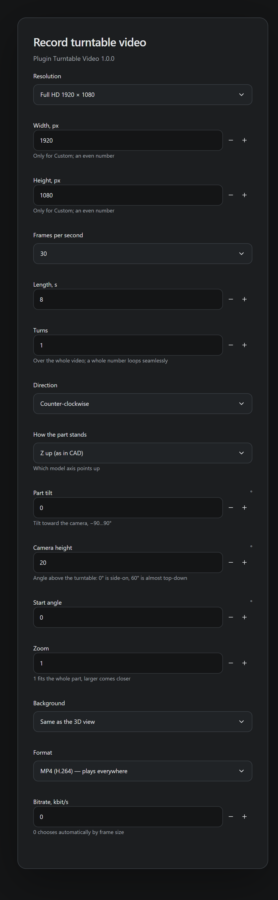
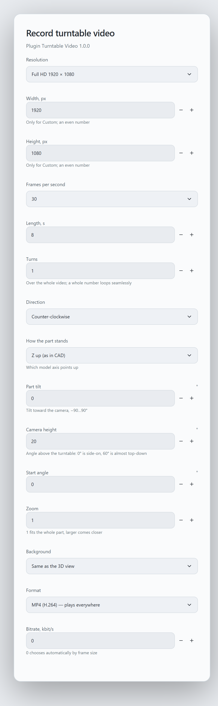

# Turntable Video — a FormaCAD plugin


[Русский](README.md) · [Plugin catalog](https://plugins.formacad.ru) · [FormaCAD](https://github.com/lovlyDev/FormaCAD)

Records a video of the model turning smoothly in a circle — for a product page, a website, a presentation or a report. You choose the resolution, frame rate, length and number of turns, how the part stands, tilt and camera height, background and format; FormaCAD renders every frame itself and encodes MP4 or WebM.


## Features

- **Resolution:** HD, Full HD, QHD, 4K, square 1080 × 1080, vertical 1080 × 1920 or custom (up to 3840 × 2160).
- **Frames per second:** 12, 24, 25, 30, 50, 60 or 120.
- **Length and turns:** 0.5 s to 10 min and 0.05 to 100 turns; a whole number of turns loops seamlessly. Clockwise or counter-clockwise.
- **How the part stands:** which model axis points up (±X, ±Y, ±Z), tilt toward the camera −90…90°, camera height −89…89°, start angle and zoom.
- **Background:** same as the 3D view, light or dark.
- **Format:** MP4 (H.264) plays everywhere; WebM (VP9) for websites. Bitrate is automatic by frame size or set by hand.
- Frames get exact timestamps, so the video is smooth even on a slow computer.

## Safety

The plugin asks for one permission, `viewport.capture`. It does **not** receive the model geometry, the frames or the file path: it only passes the recording settings, while FormaCAD renders, encodes and saves. It never changes the model, so no model-edit approval appears. Network, files and storage are out of its reach.

## Requirements

- FormaCAD **1.5.0** or newer (plugin-api 0.2).
- A system video encoder (WebCodecs): available on Windows (WebView2) and macOS; on Linux it depends on WebKitGTK and GStreamer.

## Install

1. Open the plugin page in the [plugins.formacad.ru catalog](https://plugins.formacad.ru) and click “Add to FormaCAD”.
2. Or download `orbit-video-<version>.cadplugin` from [releases](https://github.com/lovlyDev/formacad-orbit-video/releases) and use Settings → Plugins → Install from file….

## Recording a video

1. Open a project with a model.
2. Press `Ctrl K` and pick “Turntable Video: Record turntable video”.
3. Set the options and click Run.
4. Choose where to save the file. The “Recording video” window shows the frame number and percentage; Stop aborts the recording and deletes the unfinished file.

| Dark theme | Light theme |
| --- | --- |
|  |  |

Only the model is recorded — no grid, selection or dimensions. If the system cannot encode the chosen format or size, FormaCAD says so: lower the resolution or pick the other format.

## Build

```bash
rustup target add wasm32-unknown-unknown
cargo test
cargo build --release --target wasm32-unknown-unknown
cargo run --release --manifest-path <FormaCAD>/plugins/tools/cadplugin/Cargo.toml -- pack --manifest manifest.json --wasm target/wasm32-unknown-unknown/release/orbit_video.wasm --dir . --out dist
```

The host contract lives in `wit/deps/formacad-plugin`, a copy of [`formacad-plugin.wit`](https://github.com/lovlyDev/FormaCAD/blob/main/docs/plugin-api/wit/formacad-plugin.wit). Releases are built by GitHub Actions: a `vX.Y.Z` tag matching `version` in `manifest.json` creates a GitHub release with `orbit-video-X.Y.Z.cadplugin`, and the catalog publishes it automatically.

## License

[MIT](LICENSE)
