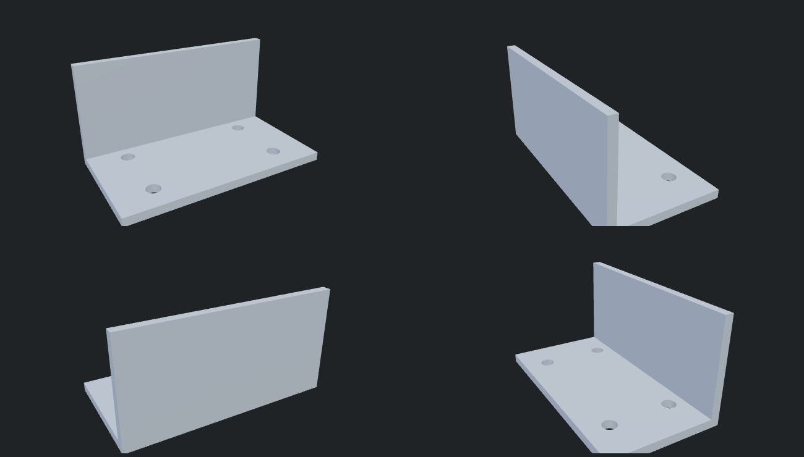
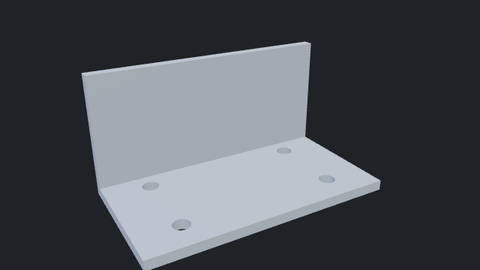
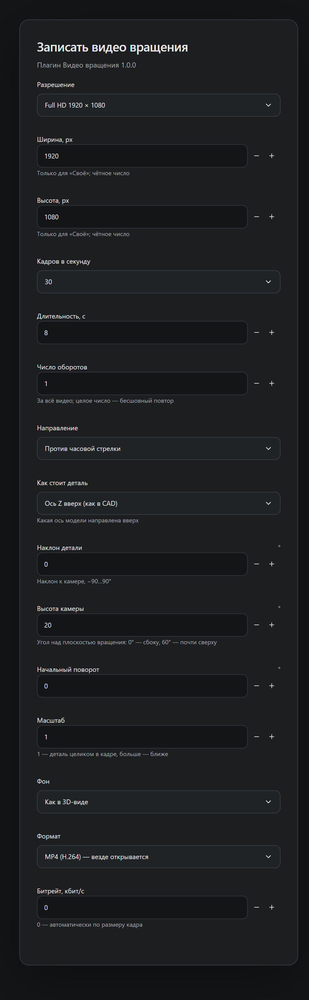
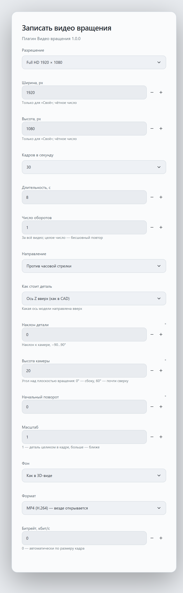

# Видео вращения — плагин FormaCAD


[English](README.en.md) · [Каталог плагинов](https://plugins.formacad.ru) · [FormaCAD](https://github.com/lovlyDev/FormaCAD)

Записывает видео модели, которая плавно вращается по кругу, — для презентации детали, сайта, карточки товара или отчёта. Вы выбираете разрешение, частоту кадров, длительность и число оборотов, как стоит деталь, наклон и высоту камеры, фон и формат; FormaCAD сам рендерит каждый кадр и кодирует MP4 или WebM.





## Возможности

- **Разрешение:** HD, Full HD, QHD, 4K, квадрат 1080 × 1080, вертикальное 1080 × 1920 или своё (до 3840 × 2160).
- **Кадров в секунду:** 12, 24, 25, 30, 50, 60 или 120.
- **Длительность и обороты:** от 0,5 с до 10 мин и от 0,05 до 100 оборотов; целое число оборотов даёт бесшовный повтор. Направление — по или против часовой стрелки.
- **Как стоит деталь:** какая ось модели направлена вверх (±X, ±Y, ±Z), наклон детали к камере −90…90°, высота камеры −89…89°, начальный поворот и масштаб.
- **Фон:** как в 3D-виде, светлый или тёмный.
- **Формат:** MP4 (H.264) — открывается везде; WebM (VP9) — для сайтов. Битрейт автоматически по размеру кадра или вручную.
- Кадры рендерятся с точными метками времени, поэтому видео плавное даже на медленном компьютере.

## Безопасность

Плагин просит одно право — `viewport.capture`. Он **не** получает геометрию модели, кадры и путь к файлу: он только передаёт параметры записи, а рендер, кодирование и сохранение выполняет FormaCAD. Модель плагин не меняет, поэтому окно подтверждения правки не появляется. Сеть, файлы и хранилище плагину недоступны.

## Требования

- FormaCAD **1.5.0** или новее (plugin-api 0.2).
- Кодировщик видео в системе (WebCodecs): есть в Windows (WebView2) и macOS; в Linux зависит от WebKitGTK и GStreamer.

## Установка

1. Откройте страницу плагина в [каталоге plugins.formacad.ru](https://plugins.formacad.ru) и нажмите «Добавить в FormaCAD».
2. Или скачайте `orbit-video-<версия>.cadplugin` из [релизов](https://github.com/lovlyDev/formacad-orbit-video/releases) и выберите «Настройки → Плагины → Установить из файла…».

## Как записать видео

1. Откройте проект с моделью.
2. Нажмите `Ctrl K` и выберите «Видео вращения: Записать видео вращения».
3. Задайте параметры и нажмите «Выполнить».
4. Выберите, куда сохранить файл. Окно «Запись видео» показывает номер кадра и процент; «Остановить» прерывает запись и удаляет недописанный файл.

| Тёмная тема | Светлая тема |
| --- | --- |
|  |  |

В видео попадает только модель — без сетки, выделения и размеров. Если система не умеет кодировать выбранный формат или размер, FormaCAD сообщит об этом: уменьшите разрешение или выберите другой формат.

## Сборка

```bash
rustup target add wasm32-unknown-unknown
cargo test
cargo build --release --target wasm32-unknown-unknown
cargo run --release --manifest-path <FormaCAD>/plugins/tools/cadplugin/Cargo.toml -- pack --manifest manifest.json --wasm target/wasm32-unknown-unknown/release/orbit_video.wasm --dir . --out dist
```

Контракт хоста лежит в `wit/deps/formacad-plugin` — копия [`formacad-plugin.wit`](https://github.com/lovlyDev/FormaCAD/blob/main/docs/plugin-api/wit/formacad-plugin.wit). Релиз собирает GitHub Actions: тег `vX.Y.Z`, совпадающий с `version` в `manifest.json`, создаёт GitHub-релиз с `orbit-video-X.Y.Z.cadplugin`, а каталог публикует его автоматически.

## Лицензия

[MIT](LICENSE)
